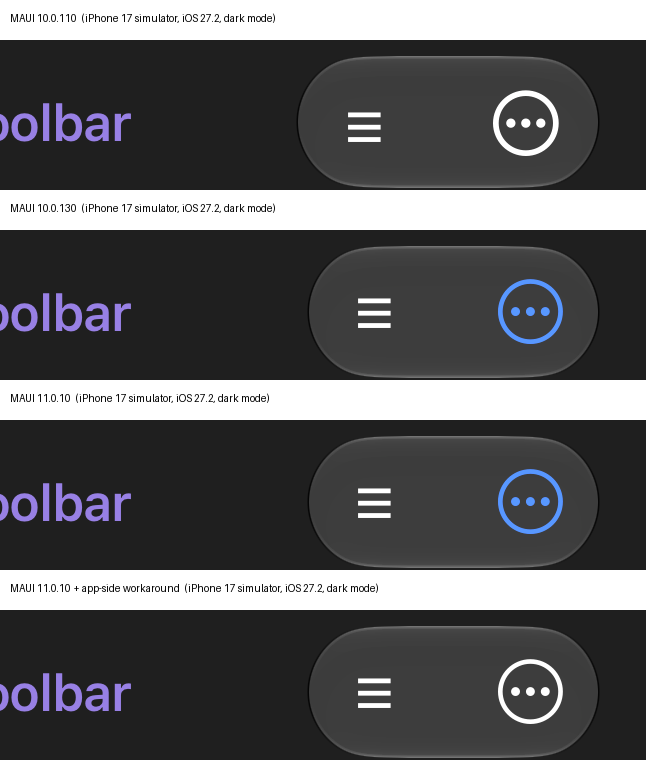

# MauiOverflowTintRepro

This project is a reproduction for a .NET MAUI regression on iOS 26 and later. When `Shell.ForegroundColor` comes from a `TabBar` style, the "..." overflow button for `Secondary` toolbar items has a different tint from the primary toolbar icons next to it. In MAUI 10.0.130 and 11.0.10 the "..." button is blue (`Shell.ForegroundColor`) and the primary icon is white (label color). In MAUI 10.0.110 both are white.



| Build (iOS 27.2, dark mode) | Primary icon (RGB) | "..." overflow button (RGB) |
|---|---|---|
| MAUI 10.0.110 | 252, 252, 252 | 251, 251, 251 |
| MAUI 10.0.130 | 252, 252, 252 | 84, 141, 237 |
| MAUI 11.0.10 | 252, 252, 252 | 84, 141, 237 |
| MAUI 11.0.10 with the workaround | 252, 252, 252 | 250, 250, 250 |

The project starts from the .NET 11 `maui` template (File > New). These are the changes:

- The project targets iOS only. The XAML files have explicit `xmlns` declarations, so the project also compiles with MAUI 10.
- `AppShell` has a `TabBar` with two tabs. A `TabBar` style sets `Shell.ForegroundColor`. The Shell and the pages do not set it. The template's `Shell` style in `Styles.xaml` no longer sets `Shell.ForegroundColor`.
- `MainPage` has one primary `ToolbarItem` with a `FontImageSource` icon and no `Color`, and two `Secondary` items that make the "..." overflow button.
- A label on the page shows the MAUI version and the iOS version.
- `Platforms/iOS/OverflowTintWorkaround.cs` contains an app-side workaround. It compiles only when you build with `-p:ApplyWorkaround=true`.

## Run the project

Use Xcode 27.2 and an iOS 26 or later simulator in dark mode.

```
dotnet build -t:Run -f net11.0-ios -p:MauiVersion=11.0.10
```

To build with MAUI 10, use this command:

```
dotnet build -t:Run -f net10.0-ios -p:ReproDotNet=10 -p:MauiVersion=10.0.110
```

- Expected result: the "..." button and the primary icon have the same tint.
- Actual result (10.0.130 and later): the "..." button is blue and the primary icon is white.

## Screenshots workflow

The `iOS toolbar screenshots` workflow builds the project with MAUI 10.0.110, 10.0.130 and 11.0.10, and with 11.0.10 plus the workaround. It takes a screenshot of each build on an iOS 27.2 simulator in dark mode.
